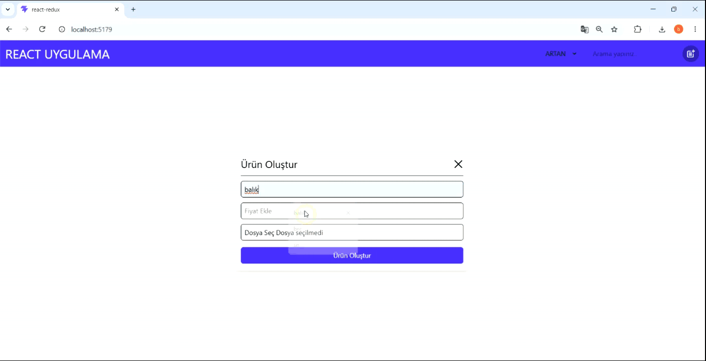

🛍️ React Product Management

<h2>📌 Proje Hakkında</h2>

Bu proje, React ve Redux Toolkit kullanılarak geliştirilmiş basit bir ürün yönetim uygulamasıdır. Kullanıcılar ürün ekleyebilir, silebilir, güncelleyebilir, arayabilir ve fiyatlarına göre sıralayabilir.

<h2>🚀 Kullanılan Teknolojiler</h2>

<ul>
  <li>React.js</li>
  <li>Redux Toolkit</li>
  <li>React Router DOM</li>
  <li>Tailwind CSS</li>
  <li>React Icons</li>
  <li>JavaScript</li>
</ul>

<h2>✨ Özellikler</h2>

<ul>
  <li>Ürün ekleme ve silme</li>
  <li>Ürün güncelleme</li>
  <li>Ürün arama</li>
  <li>Fiyata göre artan ve azalan sıralama</li>
  <li>Modal ile ürün işlemleri</li>
  <li>Redux Toolkit ile merkezi state yönetimi</li>
</ul>

<h2>🎯 Kazanımlar</h2>

Bu projede React Hooks, useState, useEffect, React Router, Redux Toolkit, CRUD işlemleri ve component yapısı üzerine pratik yapıldı.

